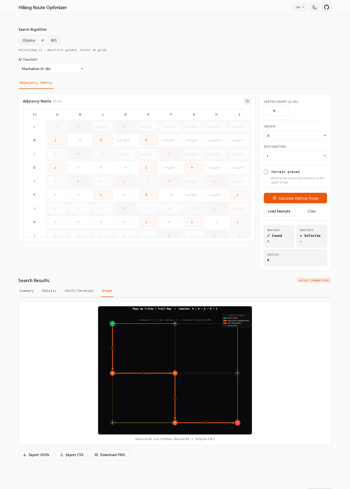

# 🥾 Hiking Route Optimizer

A full-stack, three-service application that finds the shortest and longest route between two points of a weighted graph and renders the result as a trail-map style image.

Built with **Spring Boot (Java 21)**, **React 19 + Vite + Tailwind**, and a **Python/Flask** visualization service, all orchestrated with **Docker Compose**.

[](https://openjdk.org/projects/jdk/21/)
[](https://spring.io/projects/spring-boot)
[](https://react.dev/)
[](https://www.python.org/)
[](https://www.docker.com/)
[](#testing)



---

## What it does

1. You describe a map as an **adjacency matrix** (up to 26 points, A–Z) and pick an origin and a destination.
2. The **Spring Boot API** validates the input and computes the **minimum path** with the algorithm you pick (Dijkstra, A\* or BFS) and the **maximum path** (Bellman-Ford variant).
3. The **Flask service** draws the graph with NetworkX + Matplotlib: the optimal route is highlighted and edges are colored by terrain.
4. The **React UI** shows the route, its cost, and the generated image (downloadable as PNG). The interface is available in English and Portuguese.

## Tech stack

| Layer | Technology | Port | Responsibility |
|-------|------------|------|----------------|
| Frontend | React 19, Vite, TailwindCSS, Axios | 3000 | Matrix input, route results, graph image |
| Backend | Spring Boot 3.2.5, Java 21, Maven | 8080 | REST API, input validation, path algorithms |
| Visualization | Flask, NetworkX, Matplotlib | 5000 | Graph rendering (PNG) |

```
                 ┌────────────────────┐
  Browser ─────► │ Frontend (React)   │
                 └─────────┬──────────┘
                           │ POST /api/grafo/processar        POST /graph
                           ▼                                       ▼
                 ┌────────────────────┐              ┌─────────────────────┐
                 │ Backend (Spring)   │              │ Python (Flask)      │
                 │ Dijkstra + Bellman │              │ NetworkX/Matplotlib │
                 └────────────────────┘              └─────────────────────┘
                      all three run on the same Docker network (hiking-network)
```

The frontend calls the two services independently: first the backend for the route, then the Python service to draw it. If the image service is down, the route result is still shown.

## Quick start

### With Docker (recommended)

```bash
git clone https://github.com/adrianolucasdc/hiking-route-optimizer.git
cd hiking-route-optimizer
docker compose up --build -d
```

| What | URL |
|------|-----|
| Web app | http://localhost:3000 |
| Backend API | http://localhost:8080 |
| Backend health | http://localhost:8080/actuator/health |
| Python service health | http://localhost:5000/health |

### Without Docker

```bash
# Backend (Java 21)
cd backend && ./mvnw spring-boot:run

# Frontend (Node 20) → http://localhost:5173
cd frontend && npm install && npm run dev

# Python service (Python 3.11)
cd python-service && pip install -r requirements.txt && python app.py
```

## API

### `POST /api/grafo/processar` (backend)

```json
{
  "matriz": [[0, 10, 0], [0, 0, 10], [0, 0, 0]],
  "origem": 0,
  "destino": 2,
  "algoritmo": "dijkstra",
  "heuristica": "MANHATTAN"
}
```

`algoritmo` is optional (`dijkstra` by default, or `astar` / `bfs`); `heuristica` only applies to `astar` (`MANHATTAN`, `EUCLIDEAN` or `CHEBYSHEV`). `matriz[i][j]` is the cost of going from `i` to `j`; `0` means no edge. Response:

```json
{
  "caminhoMinimo": { "caminho": [0, 1, 2], "custo": 20.0, "tipo": "MINIMO", "caminhoEncontrado": true, "mensagem": "...", "algoritmo": "Dijkstra" },
  "caminhoMaximo": { "caminho": [0, 1, 2], "custo": 20.0, "tipo": "MAXIMO", "caminhoEncontrado": true, "mensagem": "..." },
  "numeroVertices": 3,
  "status": "SUCESSO"
}
```

`status` is one of `SUCESSO`, `CAMINHO_PARCIAL`, `NENHUM_CAMINHO_ENCONTRADO`, `ERRO`.

### `POST /graph` (Python service)

Returns a `image/png`. Only `matrix` is required.

```bash
curl -X POST http://localhost:5000/graph \
  -H "Content-Type: application/json" \
  -d '{"matrix": [[0,10,0],[0,0,10],[0,0,0]], "path": [0,1,2], "labels": ["A","B","C"]}' \
  -o route.png
```

Optional fields: `path`, `labels`, `directed`, `terrainTypes`, `elevations`, `showEdgeWeights`, `figsize`. Empty or non-numeric matrix cells are treated as "no edge".

## Algorithms

| Algorithm | Complexity | Behaviour |
|-----------|------------|-----------|
| **Dijkstra** (binary min-heap) | O((V + E) log V) | Default. Guaranteed minimum cost on weighted graphs |
| **A\*** (Manhattan / Euclidean / Chebyshev) | O((V + E) log V) | Heuristic-guided; returns how many nodes it expanded |
| **BFS** | O(V + E) | Fewest edges, ignores weights while searching |
| **Bellman-Ford variant** | O(V · E) | Maximum path (always computed alongside the minimum) |

Notes on how the API runs them:

- **A\* stays optimal.** The grid heuristics only apply when the matrix is an L×L grid whose edges connect neighbouring cells; the heuristic is scaled by the smallest edge weight so it never overestimates. Manhattan is skipped if diagonal edges exist (it would not be admissible). Otherwise A\* falls back to a null heuristic, which behaves like Dijkstra, and the response `mensagem` says so.
- **BFS reports the real cost.** It picks the path with the fewest edges, then the response sums that path's weights, so you can compare it directly with Dijkstra's cost.
- Each result includes the `algoritmo` used and, for A\* and BFS, `nosExpandidos`.

### Benchmark

`BenchmarkRunner` compares the algorithms across graph types and sizes. Example results on grid graphs:

| Grid | Dijkstra | A\* (Manhattan) | Speed-up |
|------|----------|-----------------|----------|
| 10×10 | 0.42 ms | 0.09 ms | 4.7× |
| 20×20 | 1.57 ms | 0.71 ms | 2.2× |
| 30×30 | 3.53 ms | 2.12 ms | 1.7× |
| 50×50 | 14.90 ms | 11.23 ms | 1.3× |

The heuristic helps most on small grids; the advantage shrinks as the grid grows. Run it yourself:

```bash
cd backend
./mvnw exec:java -Dexec.mainClass="com.example.hiking_route.benchmark.BenchmarkMain"
# writes benchmark-results.csv and benchmark-results.md
```

## Terrain model

`TerrainCostCalculator` (backend, builder pattern) turns an elevation grid plus a terrain-type grid into a weighted graph:

- **16 terrain types** with base costs, from `TRILHA_BOA` (1.0) to dense forest (10.0), plus impassable types (deep water, rock wall, obstacle).
- **Slope penalty:** +10% cost per degree uphill; −5% per degree downhill, never below 30% of the base cost.
- **Diagonal moves** cost ×√2.

This calculator is covered by unit tests (17) and a mountain-scenario generator, but it is not part of the REST request. In the UI, the **terrain preset** selector (flat / mountain / mixed trail) only enriches the generated image with terrain colors and elevation markers.

## Project structure

```
hiking-route-optimizer/
├── backend/          Spring Boot API
│   └── src/main/java/com/example/hiking_route/
│       ├── algorithm/    PathFinder, Dijkstra, A*, BFS
│       ├── service/      Dijkstra/max-path services, graph validation
│       ├── terrain/      TerrainCostCalculator
│       ├── benchmark/    Benchmark runner + graph generators
│       ├── controller/ dto/ exception/ model/ util/
├── frontend/         React + Vite + Tailwind
│   └── src/ components/ lib/ services/
├── python-service/   Flask + NetworkX + Matplotlib
└── docker-compose.yml
```

## Testing

```bash
cd backend && ./mvnw test      # requires Java 21
```

**128 JUnit 5 + AssertJ tests**: Dijkstra, A\*, BFS, maximum path, algorithm selection through the service (including A\* optimality with fractional weights), graph validation, the `Grafo` model, the ASCII/PNG visualizer, and the terrain calculator.

## Design decisions

- **Three services, one purpose each.** Graph rendering needs Python's scientific stack, while the algorithms belong in a typed, tested JVM service. Keeping them separate lets each one be built, tested and replaced on its own.
- **Graceful degradation.** The route and the image are separate requests, so a failure in the visualization service never hides the computed route.
- **Defensive input handling.** The backend validates matrix shape, vertex bounds and connectivity before running any algorithm; the Python service tolerates empty or invalid cells instead of failing.
- **Health checks everywhere** (`/actuator/health`, `/health`), so Compose only reports the stack as up when every service is ready.

## Known limitations & next steps

- Send terrain data to the backend so the terrain cost model affects the computed route, not only the image.
- Add frontend tests and a CI pipeline (build + `mvn test` on every push).
- Deploy a public demo.

## License

Released under the [MIT License](LICENSE).

## Author

Built as a university project and later refined as a portfolio piece.
